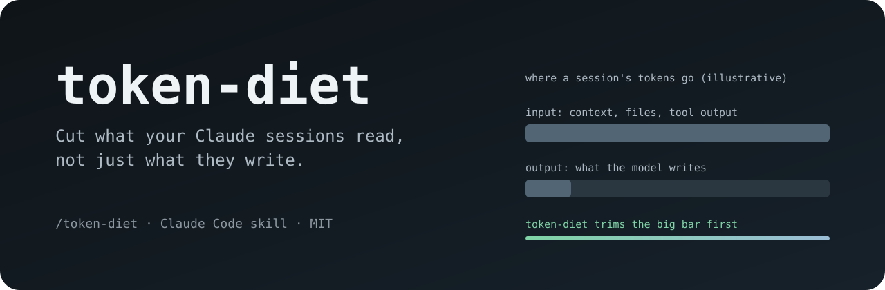

<p align="center">
  
</p>

<p align="center">
  <a href="LICENSE"></a>
  
  
</p>

<p align="center">
  <b>A Claude Code skill that makes your sessions cheaper <i>and</i> sharper.</b><br>
  Not by making Claude talk like a caveman, but by cutting the tokens that actually cost you.
</p>

---

## The idea in one minute

Everyone's first instinct for saving tokens is to make the model **write less**. That helps a little. The bill comes mostly from what the model **reads**:

| Where a session's tokens go | Share | What token-diet does about it |
|---|---|---|
| **Context it carries** (system prompt, CLAUDE.md, history) | big | keeps contexts short, one task per session, compacts per phase |
| **Files it reads** | big | search first, read line ranges, never read a file twice |
| **Tool output** (tests, logs, git, JSON) | big | trims output at the source; big data goes to a file |
| **Messages from other sessions** | grows with every agent | a fixed 6-line report format |
| **What the model writes** | small | cuts filler, keeps clarity |

So token-diet works on the big rows first, and only then on the last one.

> **It never trades correctness for tokens.** If a rule would make the work worse (skip a check, guess instead of read), the session breaks the rule and says so in one line.

---

## Before and after

A feature session reports back to its orchestrator.

<table>
<tr><th>Before (≈170 tokens)</th><th>After, with token-diet (≈45 tokens)</th></tr>
<tr><td>

```text
Hi! I've finished working on the task you
gave me. As a reminder, the goal was to
make the export keep Spanish sector names.
I looked at the codebase and found that the
prompt builder in enrichment-system.ts only
had English rules, so I added Spanish ones
for Spain and Latin America. I also wrote
tests. All the backend tests pass (992) and
the frontend tests pass too (232). I opened
a pull request, it's #308. Let me know if
you need anything else or want changes!
```

</td><td>

```text
CE-28 · needs-review
what: Spanish product+sector rules, Spain/LATAM
where: PR #308 @ d99608b7
tests: backend 992/992, frontend 232/232
next: supervisor reviews #308
```

</td></tr>
</table>

<sub>Token counts are rough (about 4 characters per token). The point is the shape, not the decimal.</sub>

Multiply that by every hand-off between a coordinator, orchestrators, feature sessions and reviewers, every day, and it adds up. The receiving session also starts its next turn with less to wade through.

---

## The five rules

### 1 · Messages between sessions: compact

Every report, brief or hand-off uses one shape:

```text
<TASK-ID> · <done | blocked | needs-review | waiting-on-user>
what:    <one line>
where:   <branch / commit SHA / PR / file path>
tests:   <suite: passed/failed>
next:    <who does what>
blocked: <only if blocked>
```

No greetings, no re-telling the other session its own brief, no "still working" pings. Paths and SHAs instead of pasted content. Long results live in a shared file; the message carries the path.

### 2 · Read only what you need

- **Search before you open:** grep or glob for the lines, then read that range.
- **Trim at the source:** `| tail -20`, `grep -c`, `--quiet`, `--format`. Counts before lists, lists before contents.
- **Big data goes to a file,** not the chat. Read back the slice you need.
- **Tests:** the narrowest suite that proves the change, then the full suite once; print the summary line.

### 3 · The cheapest model that can do the job

| Work | Model |
|---|---|
| Renames, small specified fixes, checklist reviews, scheduled services, summaries | a smaller model (e.g. Sonnet) |
| Design, tricky debugging, security reviews, anything costly to get wrong | the strongest model |

Pick the model before the session starts: switching mid-session throws away the prompt cache.

### 4 · Keep contexts short

- One session per task; close and archive it when done.
- Compact at the end of each phase, not when the context is full.
- Send wide exploration (many files, audits, long test runs) to a **subagent**, so only its conclusion lands in the main context.
- Briefs are short and self-contained: goal, files, decisions made, what done looks like.
- Stable text first, changing details last, so the **prompt cache** keeps hitting.
- Keep `CLAUDE.md` under ~200 lines and link the rest.

### 5 · With humans: clear, not caveman

Telegraphic text to a person saves little and costs comprehension (and goodwill). token-diet cuts preambles, closing recaps, "anything else?", restating the question and narrating tools, and keeps full, readable sentences.

---

## Install

**Option A: one skill, globally**

```bash
git clone https://github.com/arroyoarellanoangela/token-diet.git
mkdir -p ~/.claude/skills && cp -r token-diet/skills/token-diet ~/.claude/skills/
```

Then, in any session:

```text
/token-diet
```

It stays on until you say `stop token diet`.

**Option B: always on**

Add one line to your `~/.claude/CLAUDE.md` (or to each role's brief in a multi-session setup):

```text
Follow the token-diet skill.
```

---

## Built for multi-session setups

token-diet comes from running Claude Code as a small team: one coordinator that talks to the human, an orchestrator per project, a fresh feature session per task and a reviewer per project. In that shape most tokens are agents reading each other and re-reading the codebase, which is exactly what this skill trims. It works just as well in a single session.

---

## FAQ

<details>
<summary><b>Will Claude get worse at the task?</b></summary>

It shouldn't. The rules remove repetition and noise, not information. When a rule would hurt the work (for example, reading a whole file is genuinely needed), the session reads it and says why in one line.
</details>

<details>
<summary><b>Why not just make it answer in fewer words?</b></summary>

Because output is the small part of the bill, and forcing terse reasoning can make the model think worse. Cutting input is where the savings are.
</details>

<details>
<summary><b>Does it work with other output-style skills?</b></summary>

Yes. It pairs well with <a href="https://github.com/ayghri/i-have-adhd">i-have-adhd</a>: that one shapes replies for the human; token-diet shapes everything else.
</details>

<details>
<summary><b>How do I measure the effect?</b></summary>

Compare the usage of similar tasks before and after (your plan's usage page, or token counts in your API logs). Expect the biggest gains in long, multi-agent work, and little difference in a short single question.
</details>

---

## Contributing

Ideas, counter-examples and better rules are welcome: open an issue or a pull request. Keep the bar the same as the skill's: fewer tokens, never worse answers.

## License

[MIT](LICENSE) © 2026 Angela Arroyo
